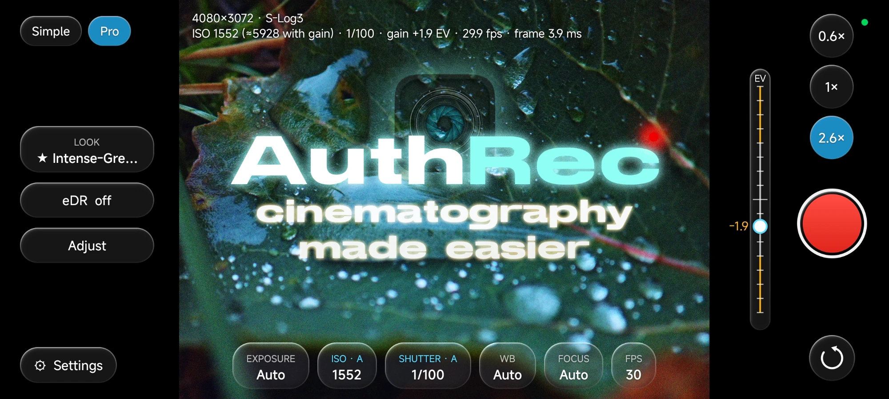

# AuthRec

Android camera app that records **log video straight from the sensor's RAW stream**. The GPU
does demosaic → colour → log → LUT in real time; the phone's ISP only meters (exposure, white
balance, colour matrix, lens shading).

## Features

- Open gate 4096×3072 (or 2K superpixel) from 14-bit RAW, 24/25/30 fps
- Apple Log / S-Log3 / LogC3
- HEVC 10-bit, HEVC 8-bit, H.264 ; up to 150 Mbps
- 16:9, 2:1, 2.39:1 and vertical support
- Live 3D LUTs and looks; look editor that exports `.cube`; LUT import available
- eDR (extended dynamic range) - customizable highlight and shadow recovery
- Temporal colour noise reduction with hot pixel fix
- AE Auto / Priority / Locked / Manual, ISO and shutter
- Tap to focus and follow, long-press to lock; native or contrast-detect AF; focus peaking
- Pause / resume recording support
- Finds lenses hidden from normal apps (ultrawide, telephoto where the phone allows)
- Recordings screen with Compress (HEVC / H.264 / AV1 on the CPU, size-capped for grain)
- Simple and Pro mode, and Photo: a burst aligned and merged in RAW, the look applied, Texture / Clarity / Dehaze, JPEG (+ optional DNG); stills while recording

## Status

Alpha. Developed on a Xiaomi 14 (Android 16 / HyperOS 3); tested on a Xiaomi 15 Ultra, Xiaomi 12
and realme GT Master Edition. Needs Android 12+, Camera2 RAW support (L3), and a strong GPU
(Snapdragon 8 Gen 2 or stronger recommended). Notes: Causes heat relatively quickly due to intense load, and support for other SoC families such as MediaTek, Google Tensor is unconfirmed. 

## Install

1. Pre-release available at `AuthRec-<version>.apk` from [Releases](https://github.com/lahaan/AuthRec/releases) and open it.

**Reporting a problem:** Settings → **Send diagnostics…** and share the file (plus the clip itself,
as a file, if a recording looks wrong).

## Build

`./gradlew assembleDebug` (Android Studio's JDK; NDK and CMake from the SDK manager, versions in
`app/build.gradle.kts`). The first build compiles x265, x264 and SVT-AV1 (a few minutes). Release
builds are signed when a git-ignored `keystore.properties` sets `storeFile`, `storePassword`,
`keyAlias` and `keyPassword`. adb test hooks: `CameraActivity.handleCommands`.

## Licence

[GPL-3.0](LICENSE). Bundled for Compress (`app/src/main/cpp/third_party`):
[x265](https://x265.org) 4.2 and [x264](https://www.videolan.org/developers/x264.html) (GPL-2.0-or-later),
[SVT-AV1](https://gitlab.com/AOMediaCodec/SVT-AV1) 4.2.0 (BSD-3-Clause-Clear + AOM patent licence).
Their licence texts ship in the app (Settings → About & licences).
